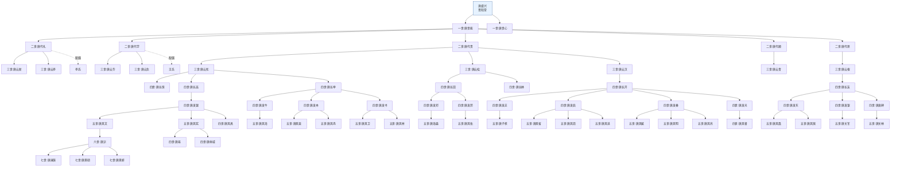

# Rxbit.Brigade.Controll — 工业控制应用

## 项目概述

基于 WPF + .NET Framework 4.8 的工业控制界面应用，采用 MVVM 架构，集成 HMI 人机界面集与 PLC 工业控制集两大模块。

## 技术栈

| 技术 | 说明 |
|------|------|
| 框架 | WPF (.NET Framework 4.8) |
| 架构 | MVVM (Model-View-ViewModel) |
| 语言 | C# |
| 平台 | x86 |
| 构建工具 | MSBuild / dotnet CLI |

## 项目结构

```
Rxbit.Brigade.Controll/
├── MainWindow.xaml / .xaml.cs       # 主窗口（侧边栏导航容器）
├── App.xaml                          # 应用入口 + 全局资源合并
├── Themes/
│   └── Generic.xaml                 # 全局样式、画刷、转换器
├── Mvvm/
│   ├── ObservableObject.cs          # MVVM 基类
│   └── Converters.cs                # 值转换器集合（Bool→Brush、Bool→Visibility 等）
├── ViewModels/
│   ├── HmiViewModels.cs             # HMI 模块 ViewModel
│   ├── HmiShellViewModel.cs         # HMI 外壳导航
│   ├── PlcViewModels.cs             # PLC 模块 ViewModel（Plc1~Plc5）
│   └── PlcShellViewModel.cs         # PLC 外壳导航
└── Views/
    ├── MainWindow.xaml              # 主窗口
    ├── HmiShellView.xaml / .cs      # HMI 模块外壳
    ├── Hmi1View.xaml ~ Hmi5View.xaml # 5 个 HMI 界面
    ├── PlcShellView.xaml / .cs      # PLC 模块外壳
    ├── Plc1View.xaml                # VISA 4工位轴控制
    ├── Plc2View.xaml                # MOTEC 自动化（抓手/拆机盘/料道）
    ├── Plc3View.xaml                # 智能控制机监控（PDU/UPS/空调）
    ├── Plc4View.xaml                # 配方编辑（步骤+参数+列表）
    └── Plc5View.xaml                # 操作员界面（产量/报警/控制）
```

## 功能模块

### HMI 人机界面集（5 个界面）

| 编号 | 界面 | 说明 |
|------|------|------|
| HMI1 | 地铁机房监测 | 机房设备状态、温度监控、能耗统计 |
| HMI2 | 美容导入仪 | 阶段卡片、操作流程、参数控制 |
| HMI3 | 核应用服务端 | 服务状态、任务队列、告警管理 |
| HMI4 | 自动化设备 | 抓手控制、拆机盘、料道监控 |
| HMI5 | 参数设置雷达 | 参数配置、卡片式设置项 |

### PLC 工业控制集（5 个界面）

| 编号 | 界面 | 说明 |
|------|------|------|
| PLC1 | VISA 4工位 | 4 工位轴控制（X/Y/Z/C 轴） |
| PLC2 | MOTEC 自动化 | 抓手控制、拆机盘、NG 料道、手控料道 |
| PLC3 | 智能控制机监控 | PDU 电压/电流/功率、UPS、空调、温湿度 |
| PLC4 | 配方编辑 | 步骤流程、参数配置、配方列表 |
| PLC5 | 操作员界面 | 产量统计、运行周期、报警记录、操作控制 |

## 架构设计

### MVVM 模式

- **Model**：业务数据模型（位于 ViewModels 文件夹，使用 `ObservableObject` 基类实现属性变更通知）
- **View**：纯 XAML 视图，通过 `{Binding}` 绑定到 ViewModel
- **ViewModel**：继承 `ObservableObject`，使用 `ObservableCollection<T>` 管理集合数据

### 导航系统

- **MainWindow** 提供左侧一级导航栏（8 个入口）
- **HmiShellView / PlcShellView** 提供二级侧边栏导航
- 每个子界面独立实现，通过 Shell 容器动态加载

### 值转换器

| 转换器 | 用途 |
|--------|------|
| NullConverter | Bool → 背景画刷（激活态/普通态） |
| NullConverter2 | Bool → 前景画刷（白/灰） |
| NullConverter3~12 | 各种状态到画刷/可见性的映射 |
| BoolToVisibilityConverter | Bool → Visibility |
| BoolToThicknessConverter | Bool → Thickness |

## 编译与发布

### 开发编译

```bash
dotnet build -c Debug
```

### Release 编译

```bash
dotnet build -c Release -p:PlatformTarget=x86 -p:Platforms=x86
```

### 发布

```bash
dotnet publish -c Release -r win-x86 --self-contained false -o publish
```

发布产物位于 `publish/` 目录，包含可执行文件 `Rxbit.Brigade.Controll.exe`。

## 运行要求

- Windows 10/11
- .NET Framework 4.8 运行时
- x86 架构

## 使用说明

1. 启动应用后，左侧导航栏选择模块
2. 选择 "HMI 人机界面集" 或 "PLC 工业控制集"
3. 在二级侧边栏中切换具体界面
4. 每个界面独立实现，互不干扰


